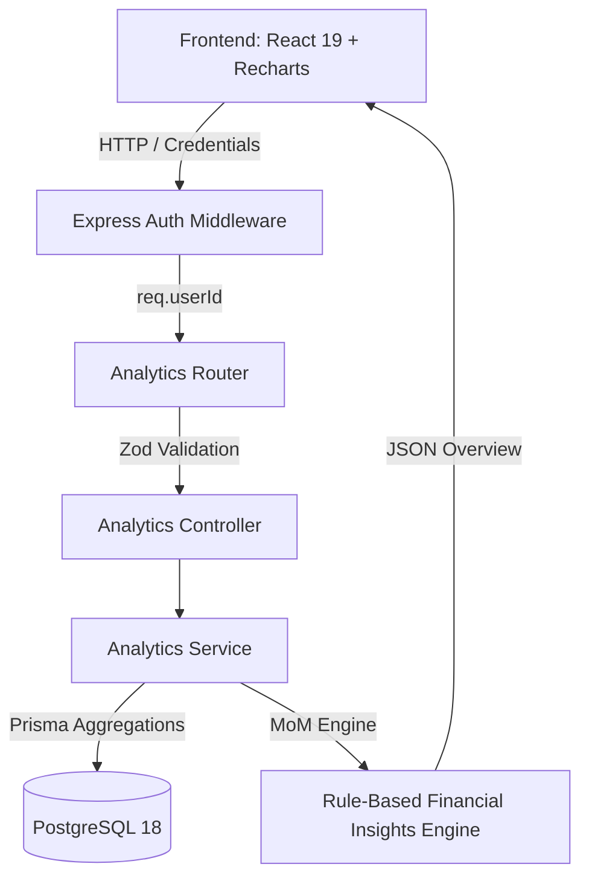

# Lumina Finance — Advanced Personal Finance & Analytics

Lumina Finance is a modern personal finance management and analytics platform engineered with React 19, TypeScript, Vite, Recharts, Express, and PostgreSQL (via Prisma ORM).

---

## 1. Analytics Architecture



- **Server-Side Aggregations**: Financial calculations, date-range filtering, and category aggregations are executed server-side via Prisma to minimize payload sizes and prevent N+1 query patterns.
- **Strict User Data Isolation**: Every database query is strictly scoped by `where: { userId }` derived from verified JWT session cookies or bearer tokens.
- **Client Synchronization**: Frontend services connect to `/api/analytics/*` with local zero-latency computation fallbacks for offline resilience.

---

## 2. Financial Calculation Rules

All monetary calculations enforce two decimal places (`.toFixed(2)` converted to IEEE 754 float safe numbers) to align with PostgreSQL `Decimal(12, 2)`:

- **Total Income**: $\sum \text{amount}$ for all transactions where `type === 'income'` in the selected period.
- **Total Expenses**: $\sum \text{amount}$ for all transactions where `type === 'expense'` in the selected period.
- **Net Cash Flow (Net Savings)**: $\text{Total Income} - \text{Total Expenses}$.
- **Savings Rate**:
  $$\text{Savings Rate} = \begin{cases} \frac{\text{Net Cash Flow}}{\text{Total Income}} \times 100 & \text{if Total Income} > 0 \\ 0\% & \text{otherwise} \end{cases}$$
- **Category Spending**: Sum of expenses grouped by category, with relative percentage $\frac{\text{Category Expense}}{\text{Total Expenses}} \times 100$.
- **Budget Utilization**:
  $$\text{Utilization} = \begin{cases} \frac{\text{Spent}}{\text{Limit}} \times 100 & \text{if Limit} > 0 \\ 0\% & \text{otherwise} \end{cases}$$
  - **Healthy**: $< 75\%$
  - **Near Limit**: $75\% - 89\%$
  - **Almost Reached**: $90\% - 100\%$
  - **Over Budget**: $> 100\%$
- **Savings Goal Progress**:
  $$\text{Progress} = \begin{cases} \min(100, \frac{\text{Current Amount}}{\text{Target Amount}} \times 100) & \text{if Target Amount} > 0 \\ 0\% & \text{otherwise} \end{cases}$$
- **Period-Over-Period Comparison (MoM)**:
  Matching contiguous comparison window of identical duration:
  $$\Delta\% = \begin{cases} \frac{\text{Current} - \text{Previous}}{\text{Previous}} \times 100 & \text{if Previous} > 0 \\ 0\% & \text{if Current} = 0 \text{ and Previous} = 0 \\ +100\% & \text{if Previous} = 0 \text{ and Current} > 0 \end{cases}$$

---

## 3. Analytics API Endpoints

All endpoints require verified authentication (`Bearer <token>` or `auth_token` cookie):

| Method | Endpoint | Query Parameters | Description |
|---|---|---|---|
| `GET` | `/api/analytics/overview` | `period`, `startDate`, `endDate` | Returns current totals, previous period baseline, MoM deltas, budget summary, and goal metrics |
| `GET` | `/api/analytics/trends` | `period`, `startDate`, `endDate`, `interval` (`daily` \| `monthly`) | Multi-series time series (`income`, `expenses`, `netCashFlow`) |
| `GET` | `/api/analytics/categories` | `period`, `startDate`, `endDate` | Categorical expense distribution with amounts, percentages, colors |
| `GET` | `/api/analytics/insights` | `period`, `startDate`, `endDate` | Automated, data-driven observations and health alerts |
| `GET` | `/api/analytics/summary` | `period`, `startDate`, `endDate` | Compact summary totals |
| `GET` | `/api/analytics/budget-performance` | *(none)* | Detailed budget breakdown with dynamic spent amounts |
| `GET` | `/api/analytics/spending-trend` | `days` (1 - 365) | Backward-compatible spending points |

---

## 4. Date-Range Conventions

Supported period filters:
- `week`: Monday 00:00:00 to Sunday 23:59:59.999 of the current week.
- `month`: 1st day 00:00:00 to last day 23:59:59.999 of the current month.
- `last_month`: 1st day 00:00:00 to last day 23:59:59.999 of the preceding month.
- `quarter` / `3months`: 90 days preceding today up to current timestamp.
- `6months`: 180 days preceding today up to current timestamp.
- `year`: January 1 00:00:00 to December 31 23:59:59.999 of current calendar year.
- `custom`: Validated user-specified `startDate` and `endDate` (`endDate >= startDate` required).

---

## 5. Smart Financial Insights Rules & Thresholds

The rule-based Smart Financial Insights engine generates deterministic observations without external paid AI services:

1. **Spending Velocity**:
   - **Increased**: Expense delta $> +10\%$ vs previous period (`warning`).
   - **Decreased**: Expense delta $< -10\%$ vs previous period (`success`).
   - **Steady**: Expense delta within $[-10\%, +10\%]$ (`info`).
2. **Category Dominance**:
   - Triggered when single category accounts for $\ge 35\%$ of total expenses (`info`).
3. **Budget Health**:
   - **Exceeded**: Any category budget where $\text{spent} > \text{limit}$ (`warning`).
   - **Approaching Limit**: Any category budget where $\text{utilization} \ge 80\%$ and $\le 100\%$ (`warning`).
4. **Savings Rate Health**:
   - **Strong Savings**: $\text{Savings Rate} \ge 20\%$ (`success`).
   - **Cash Flow Deficit**: Expenses exceed income (`warning`).
5. **Goal Milestones**:
   - **Achieved**: Any active goal at $100\%$ completion (`success`).
   - **Milestone Progress**: Nearest active goal $\ge 50\%$ completion (`success`).
   - **No Goals Prompt**: Suggest establishing a target when no goals exist (`info`).

---

## 6. How to Run Tests

### Run Backend Unit & Integration Tests (Vitest)
```powershell
cd backend
npm test
```

### Run Frontend Unit & Component Tests (Vitest)
```powershell
npm test
```

### Production TypeScript Builds
```powershell
# Frontend
npm run build

# Backend
cd backend
npm run build
```

---

## 7. Exact Windows Commands to Run the Application

### 1. Start PostgreSQL (Port 5433)
```powershell
& "C:\Program Files\PostgreSQL\18\bin\postgres.exe" -D "$env:USERPROFILE\.lumina_pgdata" -p 5433
```

### 2. Start Backend API Server (Port 5000)
```powershell
cd C:\Users\arnav\OneDrive\Desktop\projects\LuminaFinance\backend
npm run dev
```

### 3. Start Frontend Client (Port 5173)
```powershell
cd C:\Users\arnav\OneDrive\Desktop\projects\LuminaFinance
npm run dev
```

---

## 8. Known Limitations

- **Multi-Currency Conversion**: Transactions and budgets currently use the user's primary profile currency (e.g. `₹`). Multi-currency conversion rates are not yet integrated.
- **Recurring Transactions**: Auto-recurring recurring subscriptions are scheduled for future steps.
- **External AI/ML Forecasting**: Step 15 intentionally uses deterministic, mathematical rule-based insights. Advanced machine learning models (ARIMA / LSTM forecasting) will be integrated in subsequent milestones.
